# Native live viewing: development evidence

Companion PRs: [haxballjs #2](https://github.com/gavin0266/haxball.js/pull/2), [APL #15](https://github.com/gavin0266/apl-football/pull/15), [HaxballAsia #52](https://github.com/KnitidCeladon23/next_haxballasia/pull/52). This report and the actual screenshots are stored independently in each PR's repository.

## Checked source and environment

Native fork: **a13c08797ce1e84dc05de3db2b708791100e661b**. APL room/publisher: **c8b35c5ddd831b8f7a29b81bd40f671319d969a5**. Captured website runtime: **4012949c16a0fa46442f0d01b2b952c44e4e4c3d**. Later evidence-only commits do not change these runtime sources. Captures and assertions are timestamped in UTC in [capture metadata](live-viewing/captures.json) and [live-run proof](live-viewing/real-room.json).

The website ran at localhost port 3107 with the actual production live-router module hosted in an isolated Express harness on loopback port 4107. This harness contains the new relay, without the unrelated database-backed routes. These checks did not replace API responses or intercept live requests. The source was a **real, unlisted, password-protected native Haxball room**, opened through the existing Capsolver integration at 2026-10-27T12:50:36.550Z. Its two clearly labelled players were the fork's engine-driven test participants, rather than two human or WebRTC player clients. Separate native peer verification is described below. No production match records, account credentials or database data were used.

This initial section records **local development** before the hosted rollout. Its baseline confirmed development c62dd0d and production 1.1.1 (40933f3) healthy. The later user-authorized hosted development rollout and independent hosting/referee controls are recorded below; production activation remains separate.

## Actual live behavior

At **2026-10-27T13:33:57.537Z**, desktop Edge rendered the actual APL stadium, names, team colors, ball, native camera and game state. During the observed interval the native game clock advanced from **2570.767 s** to **2579.850 s**, and the absolute live playback frame advanced **560 frames** across multiple native segments. Test Red's x position changed from **-473.777** to **-418.105**. The page had **0 JavaScript errors**.

Pause held the native reader, Return to live resumed it, and the native viewport selector applied the full 1x mode. Desktop 1440x1000 and mobile-width 390x844 captures passed page-width checks. Mobile-width Edge is not physical iPhone or Safari proof. The same actual relay returned 404 for an unavailable broadcast; that UI was captured separately. Header/clock and paused status are outer UI; the pitch is the original Haxball canvas, not a mock or custom renderer.

At **2026-10-27T13:12:24.897Z**, a separate native haxball.com client successfully joined the same private room as **Live Peer Spectator** over its real WebRTC path. The host's join welcome, live native game clock and ping HUD were observed. [Native peer proof](live-viewing/native-peer.json) and the actual native-client capture record this separately; the viewer-only run itself did not open that peer.

## Automated checks and actual limitations

| Check | Observed result |
| --- | --- |
| Fork native-engine/participant contracts | 6 passed locally; Linux and Windows CI passed. Native segment bytes equal ordinary archive recording, including archive start/stop; privacy filtering and consumer/cancellation cases covered. |
| APL npm test | Passed: 207 Node test cases, 66 stadium checks and 631 engine/harness checks, plus included standalone performance/provider/Fleet checks. No Node skips or failures. |
| APL Linux CI | Native fork preflight, supervisor lifecycle and account dashboard checks passed in addition to source/history/offline checks. |
| HaxballAsia backend units | 633 passed, 3 existing database-gated skips; no failures. |
| HaxballAsia frontend units | 98 passed, no skips or failures. |
| TypeScript | Passed. |
| Local Chromium live-view regressions | 2 passed: native segment transitions, local pause/live-edge, viewport/fullscreen, unavailable state. |
| Local Windows WebKit | 1 unavailable/retry case passed; native playback case explicitly skipped after verifying the visible missing-Web-Audio error. This WebKit build lacks both AudioContext APIs. It is not reported as successful Safari playback. |
| Real room/native renderer integration | Passed against actual native data and real local HTTP relay/proxy with no live API interception; zero page errors. |

Initial runs exposed and fixed a page/iframe startup handshake race, an ambiguous view selector label, a sound-setting call before native audio initialization, an error that polling could clear, and clipped mobile error text. The first mobile browser launch failed because the locked WebKit executable was absent; installing it revealed its real Web Audio limitation. These failed attempts are not counted as passed tests. Physical iPhone Safari, sustained high-viewer load, distributed relays and production rollout were not tested.

Initial successful CI runs are recorded in [CI metadata](live-viewing/initial-ci.json). Final source/head checks are linked in each PR description; this report does not describe an older run as testing a newer source revision. Source revisions remain explicit above.

## Operations and review

Both flags default off. Private broadcasting requires an explicit listed or unlisted opt-in, and unlisted feeds stay out of discovery. Chat, announcements and moderator removal reasons are omitted at capture. The relay uses authenticated writes, read-only website proxies, bounded memory, sequence/frame validation, inflate limits and stale-feed expiry. Live-route access logging is suppressed; viewing URLs, native invites, passwords, tokens, auth/conn/IP and publishing keys are excluded from committed proof.

Deployment order is compatible website/backend, then the pinned APL package, then explicit development flags. Production is a separate authorization and release. The original streaming runtime needs no schema change; the hosting controls below add an additive default-off reservation column. The relay is process-local and requires one backend instance or sticky routing; it provides a short playback buffer rather than persistent DVR. Callback network work is queued by APL rather than blocking the native dispatcher.

## Actual captures

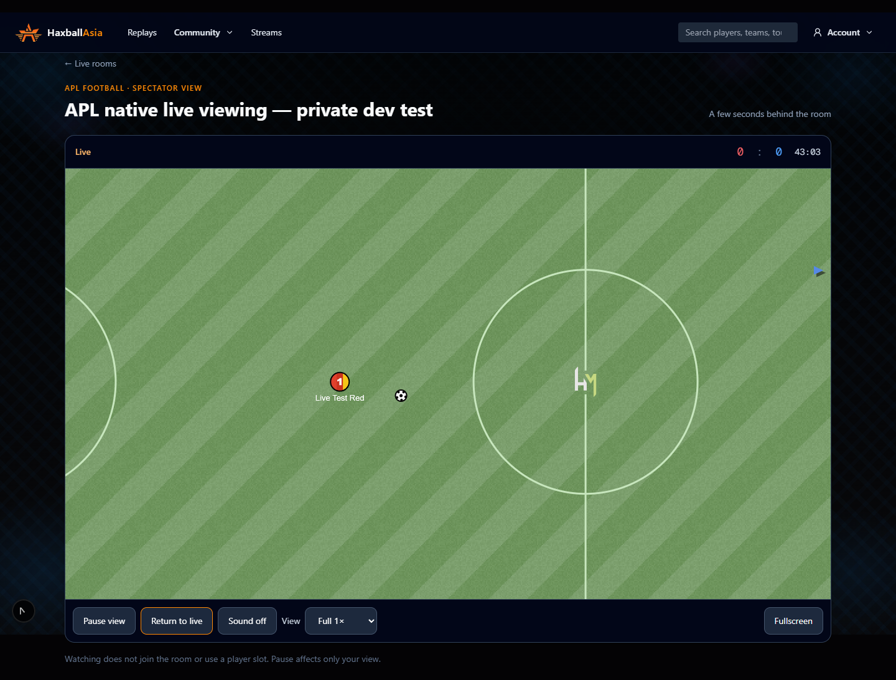

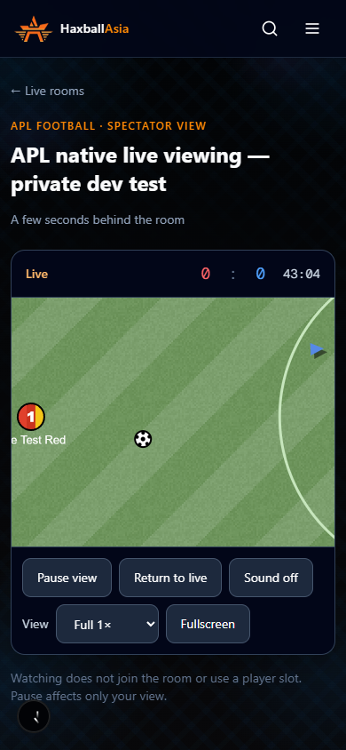

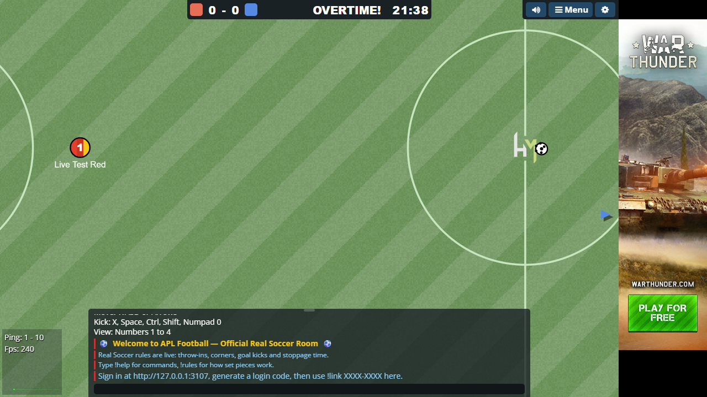

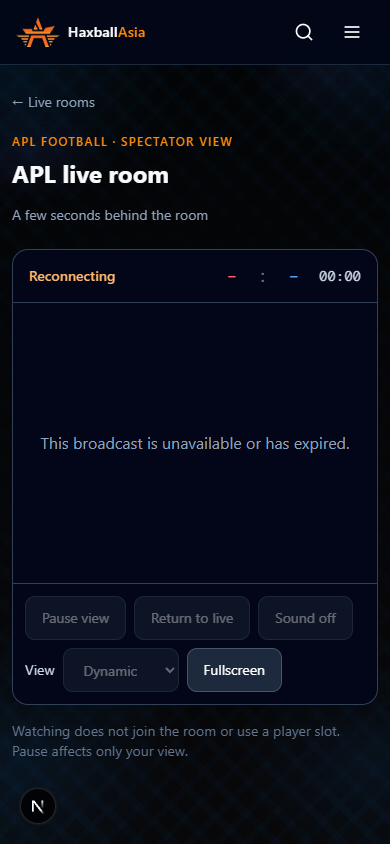

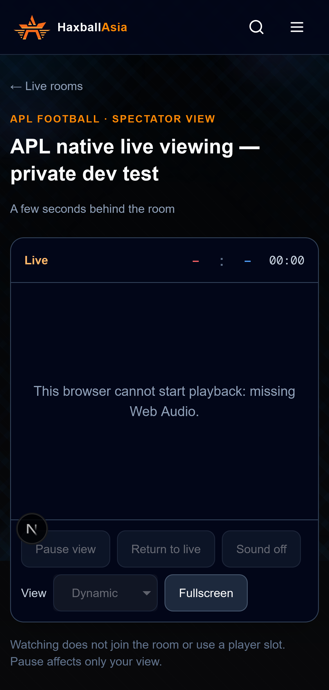

## Hosted development rollout and controls (28 October 2026, Sydney)

Website/backend **3132ec798e43855d19917f61a58ff5fd31ac7244** and the separate
development Fleet/room package **3339c96d012a9bdb16d0fabb8a6bb088afbbfeda** are
deployed. The native engine remains pinned to **a13c08797ce1e84dc05de3db2b708791100e661b**.
The user explicitly authorized this development rollout. No PR was merged and
production was not released. Production container identities, configuration
fingerprints, release revision and the production Fleet container were verified
unchanged. Previous development images/container and private state/config backup
are retained. The checked receiver retained a nonempty development DB backup.

The additive `20261028010000_fleet_live_viewing` migration adds a default-false
boolean to reservations. CI ran both fresh migrations/schema drift and a guarded
PostgreSQL preservation case against a temporary legacy reservation table; old
room name, listing and encrypted-password sentinel survived and viewing defaulted
off. The running development database confirms the column and migration.

The actual Capsolver-opened room is **hidden from Haxball's room list** and
**listed on our development /live page**. The native room host and referee panel
run on the user's Windows computer, publishing to the deployed HTTPS dev API.
There is no production fallback. Room statistics and archive recording are off;
the two labelled participants are engine-driven test players. This rollout did
not commission another provider VPS or exercise a paid website reservation.

At **2026-10-27T14:57:31.130Z**, actual referee controls removed the feed from discovery
when turned off and created a new broadcast when enabled. Hosted native playback
advanced **528 frames** across multiple segments; the native
clock advanced from 0.167 to 9.200 seconds.
Local pause/Return to live and 390px page bounds passed with zero page errors.
The native renderer, real room bytes and hosted API were used without response
interception. Screenshots 06–10 show this actual run. The original real native
WebRTC spectator proof above remains separate; no new peer join is claimed here.

Website hosting and Fleet offer **Show on HaxballAsia live viewing**, default off,
independently of Haxball listing. The referee panel offers the initial option and
a live on/off control. Changes last for the current room session; enabling again
rotates the broadcast link. Turning off stops new capture and removes discovery;
frames already delivered cannot be recalled. The actual development Fleet catalog
was healthy through both its loopback and authenticated website service path.
Its actual release packaging includes the pinned engine and controls, excludes
credentials/runtime data, and was checked without publishing to the bucket.

Added checks: four publisher/settings cases, two Fleet bridge cases, two backend
booking/forwarding cases, one PostgreSQL migration preservation case, an actual
referee UI regression, and hosting-form submissions at desktop/mobile widths.
Full APL npm test passed (213 Node cases, 66 stadium and 631 harness checks plus
the included standalone checks). Local backend: 635 passed, 4 skips after adding
the gated migration case; the database cases run explicitly in CI. Frontend: 98
passed and TypeScript passed. Local hosting browser fixtures: 2 passed; referee
UI fixture: 1 passed. Screenshot 11 is an actual local UI capture with fixture
account/catalog/API responses; it is not a paid hosting/provisioning result.
The fixture's checkbox request body is verified by the committed browser test.
The deployment browser run reported **107 passed, 1 flaky (passed on its configured
retry), 4 existing platform skips**. The flaky existing Safari collection case
failed during browser-context cleanup with runner `ENOSPC`; its retry passed.
This was CI runner storage, not the development host. The separate PR source CI
also completed successfully. The four native live-view cases passed in this run.

The initial Fleet health probe omitted its canonical Host header and triggered
automatic restoration of the prior dev container. A network-isolated diagnostic
confirmed startup; the corrected probe and external service path then passed.
The first hosting screenshot attempt used an ambiguous form selector; the
corrected room-form capture passed. Initial sandbox test attempts failed on
temporary-file rename/local socket restrictions; the unrestricted reruns passed.
These attempted/failed checks are not counted as successes.

[Successful checked development deployment](https://github.com/KnitidCeladon23/next_haxballasia/actions/runs/40523662740) and
[APL source CI](https://github.com/gavin0266/apl-football/actions/runs/40523537877).
The [rollout record](live-viewing/development-rollout.json),
[actual hosted UI assertions](live-viewing/hosted-development.json) and
[package check](live-viewing/development-package.json) provide sanitized evidence.
Physical iPhone Safari, sustained viewer load and a distributed relay remain
outside the tested scope. Final PR descriptions distinguish source CI from later
evidence-only commits.

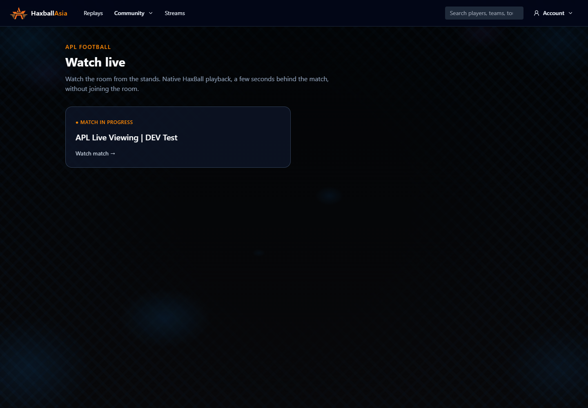

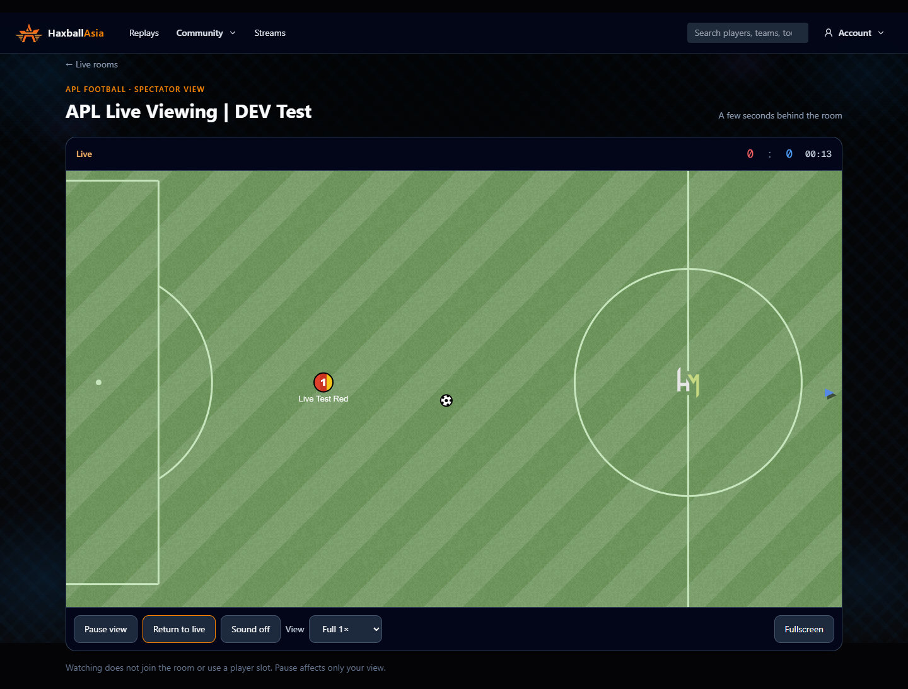

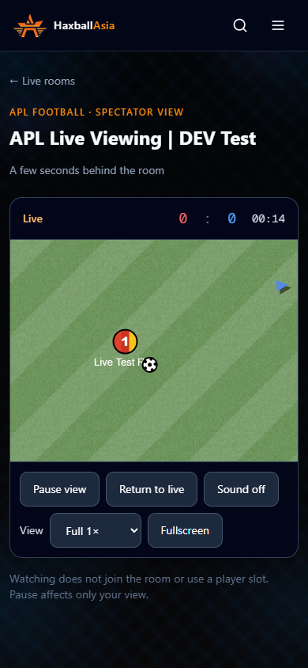

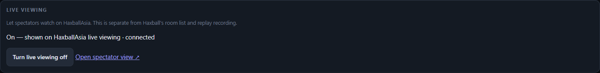

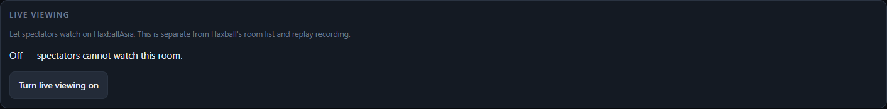

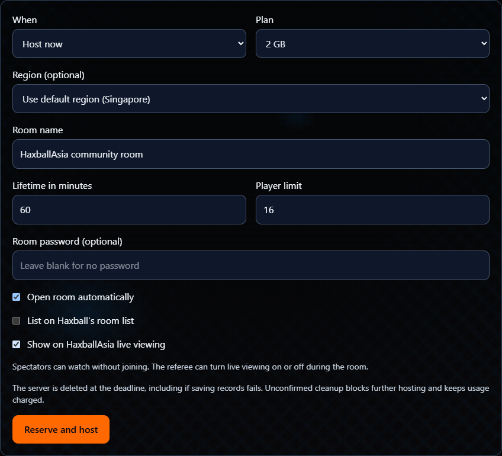

## Test room access follow-up

At 2026-10-27T15:12:39.281Z, the existing development test room was corrected without
reopening it. The ad hoc test driver had passed an empty password string to the
native API, which still marked the room locked; its generated invite also carried
the password-prompt flag. The native lock was explicitly cleared with
`setPassword(null)`, and the saved/publication invite flag was removed. A real
native WebRTC client then joined successfully **without any password prompt**,
received the APL welcome and displayed the native clock/ping HUD. The earlier
statement that a blank prompt could simply be submitted was not verified and
was incorrect.

The initial test driver only started live-segment publishing, so it was absent
from the website's separate regular room list. Its development API client now
sends that explicitly requested room-list heartbeat with public website metadata,
while the native room configuration remains hidden. This is a scoped test-host
setup correction, not a new general hosting visibility setting. The corrected
driver uses the same explicit settings for future runs. The actual hosted
development homepage rendered the room card with the corrected join target;
a second API observation verified a fresh heartbeat. No frontend/API response
interception was used. Live viewing stays enabled. No production change, provider
server creation, new solve or application source deployment was needed.

The running test process was updated through its own temporary loopback debugger,
then resumed and the debugger closed. An initial breakpoint lookup and a later
access to an uncaptured local binding failed; the scoped room-only operation
passed. The failed native join attempt still saw the stale prompt flag; the
corrected URL passed. The local referee panel join target was also corrected; its protected state
was verified to contain the password-free invite. Private join URLs and panel credentials remain
excluded from committed proof. See [room access assertions](live-viewing/room-access-followup.json)
and [new native client assertions](live-viewing/native-join-no-password.json).

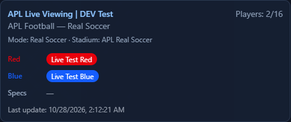

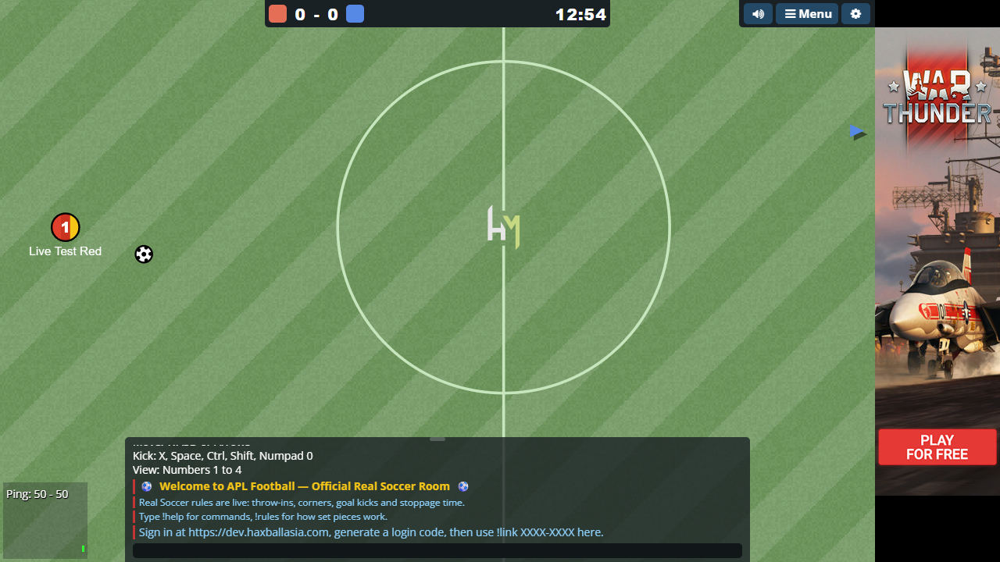
